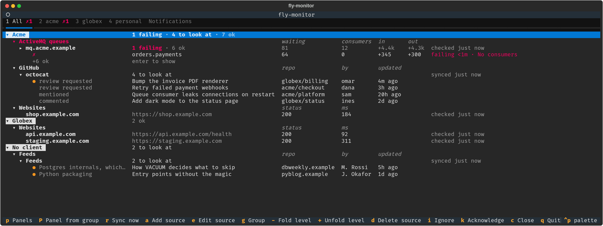
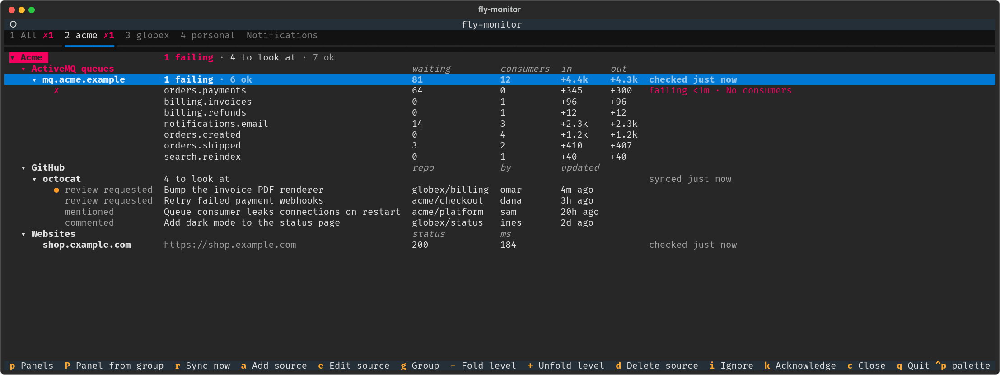
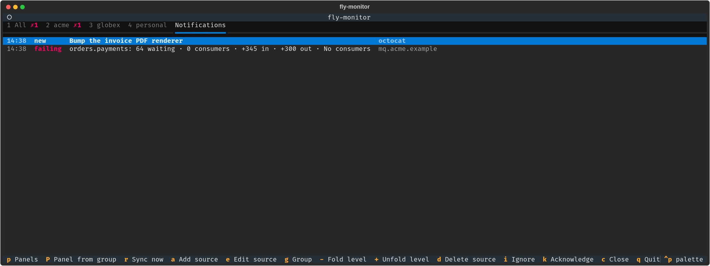
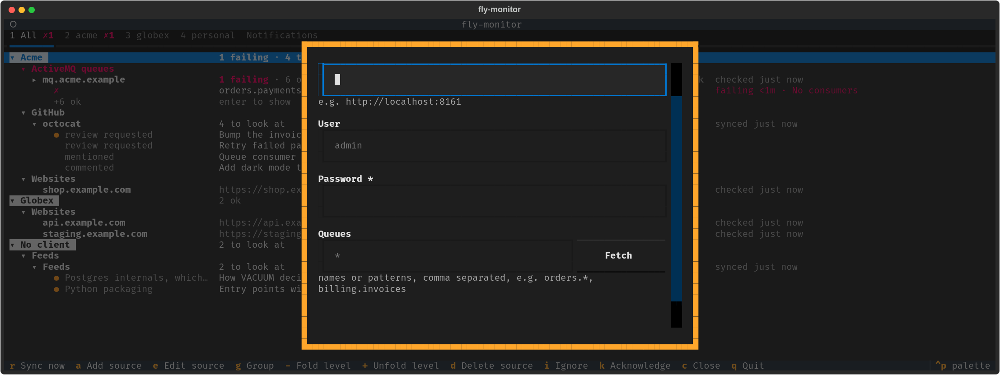

# fly-monitor

One terminal view of the things you'd otherwise check in five browser tabs: GitHub review
requests and mentions, website uptime, ActiveMQ Classic queues, and blog posts a Claude model
picks out for you from your RSS/Atom feeds.

It stays quiet while everything is fine. When something needs you, it goes red, moves to the
top, and pops up a desktop notification.



*Everything at a glance, grouped by client. A queue lost its consumers, so the broker turned
red. GitHub, the websites and the feeds wait below. (All data in these screenshots is made up.)*

## What it does

**Tells you what's wrong, not just that something is.** Each queue row shows messages waiting,
consumers, and messages in and out since the last check. A queue fails on rules you choose
(no consumers, stuck, backlog), and only after several bad checks in a row, so one blip
doesn't wake you up.



*A panel per client. Here the Acme broker is unfolded: `orders.payments` has 64 messages
waiting and nobody reading them. The tab shows `✗1` even when you're looking elsewhere.*

**Keeps a log of what changed.** Every new review request, failing queue or recovery lands in
the Notifications tab, with a desktop popup when it happens.



**Adding a source is a form, not a config file.** Pick a type, fill in the fields. For
ActiveMQ, `Fetch` lists the broker's queues so you can choose. Passwords go to your OS keyring.



**Grows with plugins.** Each source type is a small Python plugin. Write your own for anything
that has an API (see [Writing a plugin](#writing-a-plugin)).

## Run it

```sh
uv run fly-monitor         # a add · e edit · g group · -/+ fold/unfold a level · d delete · Enter open/fold · r sync · i ignore · k acknowledge · c close · p panels · q quit
uv run fly-monitor check   # test each source's connection
uv run pytest
```

## How it works

Sources live in `~/.local/share/fly-monitor/state.db` (owner-only). An existing
`~/.config/fly-monitor/config.toml` is imported once on first run (see `config.example.toml`).

Secrets typed into the form go to your OS keyring (GNOME Keyring, KWallet, macOS Keychain,
Windows Credential Manager), never into that database. Without a keyring, for example over SSH,
use a `gh:<user>` or `env:VAR` reference instead, which stores no secret at all.

A website is failing when 5 of its last 10 checks failed, and recovers after 3 good checks in a row
(both adjustable when adding it). After a recovery only new checks count, so a flaky site doesn't flap.

An ActiveMQ queue has a bad check when one of its checks fires: no consumers, stuck (messages waiting
but none dequeued since the last sync) or a backlog. You can untick them and change the numbers when
adding the broker. By default a queue is failing after 3 bad checks in a row, synced every minute.

New GitHub items, and websites or queues going failing or recovering, raise a desktop popup (notify-send) and an in-app toast,
while fly-monitor is open. A source's first sync stays quiet. A source's header turns red while one of its
rows is failing, even when folded, and failing rows are listed first.

Give each source a client and an environment (`e` to edit). The overview groups by client, then kind;
press `g` for kind only, environment, or a flat list. Healthy sources take one line.

## Writing a plugin

Want to monitor something else? Write a plugin: see [PLUGINS.md](PLUGINS.md) and the
example in [`examples/fly-monitor-disk`](examples/fly-monitor-disk).

## Panels

Split the overview into tabs, one per client, tag, group or whatever you like. A panel is a saved
filter: it shows the sources whose client, environment, tag or type is one of the values you give.
Values in one field are "any of"; different fields must all match, so client `acme` and environment
`prod` shows acme's prod sources. You can also tick sources by hand; those are always in.

- `p` opens the panel manager: new, rename, reorder, delete, edit the filter. It suggests values
  already in use and shows how many sources match as you type.
- `P` on a group header (say the `acme` client) makes a panel for that group in one key.
- `1`–`9` or `Tab`/`Shift+Tab` switch panels. Each tab shows its failing count, so trouble in a
  panel you aren't looking at still shows.
- A new source tagged `personal` turns up in a "Personal" panel by itself, no editing needed.
- **All** is always first and can't be deleted. Deleting a panel never deletes a source.
- **Notifications**, the last tab, lists this session's events, newest first. Enter opens one.
  Toasts and popups still fire for every source, whichever panel is open.

Panels and the last one you opened are kept across restarts.

## License

MIT. See [LICENSE](LICENSE).
